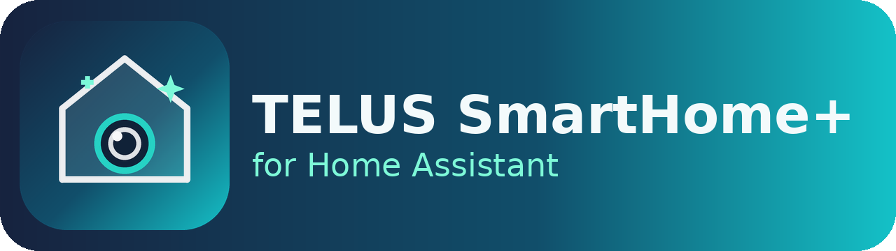

<div align="center">



### Bring your TELUS SmartHome+ cameras and devices into Home Assistant — live video, AI detections, sensors and all — without giving up the TELUS app.

[](CHANGELOG.md)
[](https://hacs.xyz/)
[](https://www.home-assistant.io/)
[](LICENSE)
[](#roadmap)

</div>

---

> ⚠️ **Unofficial.** This project is not affiliated with, endorsed by, or supported by TELUS. It was built by reverse-engineering the TELUS SmartHome+ app for personal interoperability with equipment the owner already pays for. Use it with your own account, at your own risk. TELUS could change their platform and break it at any time.

TELUS SmartHome+ is a closed, white-label platform with no public API. This project gives Home Assistant a native integration for it, plus a small streaming bridge that turns the camera's AWS Kinesis WebRTC feed into a plain RTSP stream HA (and Apple HomeKit) can play.

## ✨ Features

- 🔐 **Headless login** with your SmartHome+ email + password — no tokens to copy, auto-refreshes itself.
- 📹 **Live camera video** in Home Assistant (and on to Apple HomeKit / Apple TV via HA's HomeKit Bridge).
- 🤖 **AI Sensor** — see *what* the camera detected: **Person · Vehicle · Animal · Package · Motion**, with confidence and bounding box.
- 🏃 **Motion**, **connectivity**, **Wi-Fi signal**, and **device-temperature** sensors.
- ♻️ **Self-healing stream** — the camera caps live sessions (~10 min); the bridge notices and reconnects on its own in seconds. No more reloading HA.
- 🎞️ **Recorded clips** — browse and play your TELUS cloud recordings from HA's *Media* sidebar.
- 🧩 **Multi-camera** — one bridge container serves every TELUS camera on your account automatically.
- 🍏 **HomeKit-ready** — the RTSP stream works with HA's built-in HomeKit Bridge.

## 🧭 How it works

The integration owns authentication and data. Live video needs a tiny helper because the camera speaks **AWS Kinesis Video Streams (WebRTC)**, which HA can't play directly — so a bridge converts it to RTSP once, and everything downstream just reads RTSP.

```
                    ┌─────────────────────────────┐
                    │   TELUS SmartHome+ Cloud     │
                    │  (Platform API + AWS KVS)    │
                    └───────────────┬─────────────-┘
          auth, device data,        │        camera: KVS WebRTC (H.264)
          live-stream config        │
                    ┌───────────────┴──────────────┐
                    ▼                               ▼
        ┌───────────────────────┐      ┌────────────────────────────┐
        │  HA Integration       │      │   gst_bridge (Docker)      │
        │  custom_components/    │ POST │  webrtcbin → RTSP          │
        │  telus_smarthome       ├─────►│  + MediaMTX  + watchdog    │
        │  (login, entities,     │ /start      │                     │
        │   AI Sensor, camera)   │      └──────────────┬─────────────┘
        └───────────┬───────────┘                      │ RTSP
                    │                                   ▼
                    │                        ┌────────────────────┐
                    └───────────────────────►│  Home Assistant    │
                       entities + stream     │  → HomeKit / Apple │
                                             └────────────────────┘
```

There are **two pieces** to install:

| Piece | What it does | Required for |
| --- | --- | --- |
| `custom_components/telus_smarthome` | Login, devices, sensors, AI Sensor, camera entity | Everything |
| `gst_bridge/` (Docker) | KVS-WebRTC → RTSP converter | **Live video only** |

If you only want sensors and AI detections, you can skip the bridge. For live video, run the bridge on any always-on Docker host on your LAN.

## 📦 Installation

### 1 — Integration (via HACS — recommended)

[](https://hacs.xyz/docs/faq/custom_repositories/)

1. In Home Assistant: **HACS → ⋮ (top right) → Custom repositories**.
2. Add this repository URL, category **Integration**, and click **Add**.
3. Find **TELUS SmartHome+** in HACS, click **Download**.
4. **Restart Home Assistant.**
5. **Settings → Devices & Services → Add Integration → TELUS SmartHome+**, and sign in with your SmartHome+ email and password.

<details>
<summary>Or install manually</summary>

Copy `custom_components/telus_smarthome/` into your HA `config/custom_components/` folder and restart.
</details>

### 2 — Streaming bridge (for live video)

On any always-on machine with Docker on your LAN:

```bash
git clone https://github.com/akramercury/telus-smarthome-ha.git
cd telus-smarthome-ha/gst_bridge
cp ../.env.example .env        # then edit .env and set LAN_IP to this host's IP
docker compose up -d --build
```

Then in HA: **Settings → Devices & Services → TELUS SmartHome+ → Configure**, and set the **bridge URL** to `http://<this-host-ip>:8787`.

Check it's healthy any time:

```bash
curl -s http://<this-host-ip>:8787/health
```

## 🎛️ Entities

| Entity | Type | Notes |
| --- | --- | --- |
| Outdoor Camera | `camera` | Live view via the bridge |
| **AI Sensor** | `sensor` | **Person / Vehicle / Animal / Package / Motion** + confidence, bounding box |
| Motion | `binary_sensor` | PIR + AI motion |
| Connectivity | `binary_sensor` | Online/offline |
| Wi-Fi signal | `sensor` | dBm |
| Device temperature | `sensor` | °C |

> **Tip:** automate on `state` of the AI Sensor — e.g. *"when AI Sensor is `Person` after sunset → turn on the porch light."*

## 🗺️ Roadmap

- [ ] **On-demand streaming** — only hold the camera while HA is actively viewing, freeing it (and upload bandwidth) for the TELUS app and clip playback.
- [ ] **Audio** in the HA stream.
- [ ] **Real-time events via MQTT** — instant Person/Vehicle/Package alerts, matching the app's push notifications.
- [x] **Saved clips** — in the Media browser (0.5.0). Download-to-MP4 via `tools/fetch_clips.py`.
- [ ] Doorbell + siren + spotlight controls.

## 🎞️ Recorded clips

Open **Media** in the HA sidebar -> **TELUS SmartHome+** -> pick a camera. Clips
are the same ones the TELUS app shows (retention depends on your TELUS plan).
Pick one to play it, or use it in a dashboard Media Control / cast it to a
speaker or TV. To save clips as MP4 files, see [`tools/fetch_clips.py`](tools/fetch_clips.py).

## 🩺 Troubleshooting

- **Media browser shows no clips:** open `/config/telus_smarthome_clips.json` (written on first browse) and open an issue with its contents (remove anything private) so field names can be adjusted.
- **All entities go *Unavailable* after a few minutes:** fixed in 0.4.0 (token now refreshes on 403). Make sure you're on the latest.
- **Camera black / "404" in HA stream logs:** the bridge isn't publishing — check `docker compose logs -f bridge` and the `/health` endpoint, and confirm the bridge URL and `LAN_IP` are correct.
- **Stream drops every ~10 minutes:** that's the camera's session cap; the self-healing bridge (0.4.0) reconnects automatically — watch for `auto-reconnect` in the logs.

## 🎨 Branding

The logo and icon ship **with the integration**, in
[`custom_components/telus_smarthome/brand/`](custom_components/telus_smarthome/brand/):

```
custom_components/telus_smarthome/brand/
├── icon.png      # 256×256
├── icon@2x.png   # 512×512
├── logo.png      # wide banner
└── icon.svg      # vector source
```

Since **Home Assistant 2026.3**, custom integrations serve their own brand
images locally from this `brand/` folder — they override the brands CDN, so the
icon shows on the device/integration card with **no submission to
home-assistant/brands and no extra config**. Just install and restart.
Supported filenames also include `dark_icon.png`, `dark_logo.png`, and the
`@2x` variants.

## 🙏 Acknowledgements

Built through API reverse-engineering of the TELUS SmartHome+ app. TELUS SmartHome+ is a white-label platform; your mileage may vary by region and firmware.

## 📄 License

[MIT](LICENSE) © 2026 Akram Mahmoud
