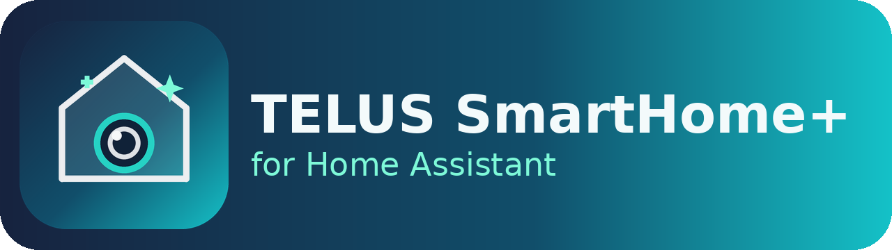

<div align="center">



### Bring your TELUS SmartHome+ cameras and devices into Home Assistant — live video, AI detections, sensors and all — without giving up the TELUS app.

[](CHANGELOG.md)
[](https://hacs.xyz/)
[](https://www.home-assistant.io/)
[](LICENSE)
[](#roadmap)

</div>

---

> ⚠️ **Unofficial.** This project is not affiliated with, endorsed by, or supported by TELUS. It was built by reverse-engineering the TELUS SmartHome+ app for personal interoperability with equipment the owner already pays for. Use it with your own account, at your own risk. TELUS could change their platform and break it at any time.

TELUS SmartHome+ is a closed, white-label platform with no public API. This project gives Home Assistant a native integration for it, plus a small streaming bridge that turns the camera's AWS Kinesis WebRTC feed into a plain RTSP stream HA (and Apple HomeKit) can play.

## ✨ Features

- 🔐 **Headless login** with your SmartHome+ email + password — no tokens to copy, auto-refreshes itself.
- 🔊 **Audio** with the live stream (can be switched off).
- 📹 **Live camera video** in Home Assistant (and on to Apple HomeKit / Apple TV via HA's HomeKit Bridge).
- 🤖 **AI Sensor** — see *what* the camera detected: **Person · Vehicle · Animal · Package · Motion**, with confidence and bounding box.
- 🏃 **Motion**, **connectivity**, **Wi-Fi signal**, and **device-temperature** sensors.
- ♻️ **Self-healing stream** — the camera caps live sessions (~10 min); the bridge notices and reconnects on its own in seconds. No more reloading HA.
- 🎞️ **Recorded clips** — browse and play your TELUS cloud recordings from HA's *Media* sidebar.
- 🧩 **Multi-camera** — one bridge container serves every TELUS camera on your account automatically.
- 🍏 **HomeKit-ready** — the RTSP stream works with HA's built-in HomeKit Bridge.

## 🧭 How it works

The integration owns authentication and data. Live video needs a tiny helper because the camera speaks **AWS Kinesis Video Streams (WebRTC)**, which HA can't play directly — so a bridge converts it to RTSP once, and everything downstream just reads RTSP.

```
                    ┌─────────────────────────────┐
                    │   TELUS SmartHome+ Cloud     │
                    │  (Platform API + AWS KVS)    │
                    └───────────────┬─────────────-┘
          auth, device data,        │        camera: KVS WebRTC (H.264)
          live-stream config        │
                    ┌───────────────┴──────────────┐
                    ▼                               ▼
        ┌───────────────────────┐      ┌────────────────────────────┐
        │  HA Integration       │      │   gst_bridge (Docker)      │
        │  custom_components/    │ POST │  webrtcbin → RTSP          │
        │  telus_smarthome_plus       ├─────►│  + MediaMTX  + watchdog    │
        │  (login, entities,     │ /start      │                     │
        │   AI Sensor, camera)   │      └──────────────┬─────────────┘
        └───────────┬───────────┘                      │ RTSP
                    │                                   ▼
                    │                        ┌────────────────────┐
                    └───────────────────────►│  Home Assistant    │
                       entities + stream     │  → HomeKit / Apple │
                                             └────────────────────┘
```

There are **two pieces** to install:

| Piece | What it does | Required for |
| --- | --- | --- |
| `custom_components/telus_smarthome_plus` | Login, devices, sensors, AI Sensor, camera entity | Everything |
| `gst_bridge/` (Docker) | KVS-WebRTC → RTSP converter | **Live video only** |

If you only want sensors and AI detections, you can skip the bridge. For live video, run the bridge on any always-on Docker host on your LAN.

## 📦 Installation

### 1 — Integration (via HACS — recommended)

[](https://hacs.xyz/docs/faq/custom_repositories/)

1. In Home Assistant: **HACS → ⋮ (top right) → Custom repositories**.
2. Add this repository URL, category **Integration**, and click **Add**.
3. Find **TELUS SmartHome+** in HACS, click **Download**.
4. **Restart Home Assistant.**
5. **Settings → Devices & Services → Add Integration → TELUS SmartHome+**, and sign in with your SmartHome+ email and password.

<details>
<summary>Or install manually</summary>

Copy `custom_components/telus_smarthome_plus/` into your HA `config/custom_components/` folder and restart.
</details>

### 2 — Streaming bridge (for live video)

On any always-on machine with Docker on your LAN:

```bash
git clone https://github.com/akramercury/telus-smarthome-ha.git
cd telus-smarthome-ha/gst_bridge
cp ../.env.example .env        # then edit .env and set LAN_IP to this host's IP
docker compose up -d --build
```

Then in HA: **Settings → Devices & Services → TELUS SmartHome+ → Configure**, and set the **bridge URL** to `http://<this-host-ip>:8787`.

The compose file caps memory/CPU/processes and rotates logs, so a misbehaving
container is restarted instead of growing. Audio is on by default; set
`ENABLE_AUDIO=0` in `.env` for video-only. The camera mic is quiet, so
`AUDIO_GAIN_DB` (default 15) boosts it; raise it to 25 if speech is still faint.
**`LAN_IP` in `.env` must be set** or HA is told `127.0.0.1` and can't find the stream.

Check it's healthy any time:

```bash
curl -s http://<this-host-ip>:8787/health
```

## 🎛️ Entities

| Entity | Type | Notes |
| --- | --- | --- |
| Outdoor Camera | `camera` | Live view via the bridge |
| **AI Sensor** | `sensor` | **Person / Vehicle / Animal / Package / Motion** + confidence, bounding box |
| Motion | `binary_sensor` | PIR + AI motion |
| Connectivity | `binary_sensor` | Online/offline |
| Wi-Fi signal | `sensor` | dBm |
| Device temperature | `sensor` | °C |

> **Tip:** automate on `state` of the AI Sensor — e.g. *"when AI Sensor is `Person` after sunset → turn on the porch light."*

## 🗺️ Roadmap

- [ ] **On-demand streaming** — only hold the camera while HA is actively viewing, freeing it (and upload bandwidth) for the TELUS app and clip playback.
- [x] **Audio** in the HA stream (0.7.0).
- [ ] **Real-time events via MQTT** — instant Person/Vehicle/Package alerts, matching the app's push notifications.
- [x] **Saved clips** — Media browser, download-to-MP4, and optional auto-save (0.6.0).
- [ ] Doorbell + siren + spotlight controls.

## 🎞️ Recorded clips

Open **Media** in the HA sidebar -> **TELUS SmartHome+** -> pick a camera. Clips
are the same ones the TELUS app shows (retention depends on your TELUS plan).
Pick one to play it, or use it in a dashboard Media Control / cast it to a
speaker or TV. To save clips as MP4 files, see [`tools/fetch_clips.py`](tools/fetch_clips.py).

### Saving clips as MP4

- **One at a time:** in the Media browser pick **Play & download** — the clip is
  saved to `media/telus_clips/` and plays from your HA (use the player's ⋮ menu
  to download it to your PC).
- **Automatically:** *Settings -> Devices & Services -> TELUS SmartHome+ ->
  Configure* -> enable **Auto-save new recorded clips** and choose how many days
  to keep. Off by default; clips are typically 10-100 MB each.
- **Choose where they go:** set **Save folder for clips** in Configure — e.g. a
  mounted network share like `/media/nas/cameras`. Blank = `media/telus_clips`.
- **From an automation:** call the service `telus_smarthome_plus.download_clip`
  (optionally with `device_id` / `clip_id`; default is the newest clip).

Requires `ffmpeg` on the HA host (included with Home Assistant OS/Container).

## 🩺 Troubleshooting

- **Media browser shows no clips:** open `/config/telus_smarthome_plus_clips.json` (written on first browse) and open an issue with its contents (remove anything private) so field names can be adjusted.
- **All entities go *Unavailable* after a few minutes:** fixed in 0.4.0 (token now refreshes on 403). Make sure you're on the latest.
- **Camera black / "404" in HA stream logs:** the bridge isn't publishing — check `docker compose logs -f bridge` and the `/health` endpoint, and confirm the bridge URL and `LAN_IP` are correct.
- **Stream drops every ~10 minutes:** that's the camera's session cap; the self-healing bridge (0.4.0) reconnects automatically — watch for `auto-reconnect` in the logs.

## 🎨 Branding

The logo and icon ship **with the integration**, in
[`custom_components/telus_smarthome_plus/brand/`](custom_components/telus_smarthome_plus/brand/):

```
custom_components/telus_smarthome_plus/brand/
├── icon.png      # 256×256
├── icon@2x.png   # 512×512
├── logo.png      # wide banner
└── icon.svg      # vector source
```

Since **Home Assistant 2026.3**, custom integrations serve their own brand
images locally from this `brand/` folder — they override the brands CDN, so the
icon shows on the device/integration card with **no submission to
home-assistant/brands and no extra config**. Just install and restart.
Supported filenames also include `dark_icon.png`, `dark_logo.png`, and the
`@2x` variants.

## 🙏 Acknowledgements

Built through API reverse-engineering of the TELUS SmartHome+ app. TELUS SmartHome+ is a white-label platform; your mileage may vary by region and firmware.

## 📄 License

[MIT](LICENSE) © 2026 Akram Mahmoud


### Deploying next to Home Assistant on the same host (recommended)

Bind everything to loopback so nothing else on the LAN can read the stream or
publish onto it (MediaMTX allows anonymous publish by default). In
`gst_bridge/docker-compose.override.yml` (auto-merged by compose, gitignored;
`docker compose config` shows the effective result):

```yaml
services:
  mediamtx:
    environment:
      MTX_RTSPADDRESS: "127.0.0.1:8556"   # also moves off 8554 if another RTSP server owns it
  bridge:
    environment:
      RTSP_PUBLISH_BASE: "rtsp://127.0.0.1:8556"
      RTSP_READ_BASE: "rtsp://127.0.0.1:8556"
      BRIDGE_HOST: "127.0.0.1"
```

and set the integration's bridge URL to `http://127.0.0.1:8787`. If Home
Assistant runs on another machine, keep the defaults and set `LAN_IP` in `.env`
instead; the bridge logs a warning at startup when `RTSP_READ_BASE` is
loopback-only.

### Verifying the bridge

- `curl -s http://127.0.0.1:8787/health | jq` — healthy looks like
  `ok: true, degraded: false`, one session with `healthy: true`,
  `secs_since_frame` near 0, `nack_negotiated: true`, and `process.ffmpeg_children`
  equal to the number of cameras. Failure signatures: `secs_since_frame` past 8
  (camera stopped sending), `gave_up: true` (needs the camera opened once in HA
  to deliver fresh credentials), `wedged_sessions > 0` or `ffmpeg_children` above
  the session count (restart the container), MediaMTX logging
  `no one is publishing` (nothing reached the publish step).
- In Home Assistant the same data is on `binary_sensor.<camera>_bridge_stream`
  (attributes) and `sensor.<camera>_bridge_reconnects`.
- The bridge logs `answer rtcp-fb: ... nack, nack pli` once per session: that is
  the camera agreeing to retransmit lost packets. If `nack` disappears, loss
  recovery is off and recordings will smear again.
- Timestamps: `ffprobe -rtsp_transport tcp -show_entries packet=pts_time
  -read_intervals '%+15' rtsp://127.0.0.1:8556/telus_<id>` should take about 15
  wall-clock seconds and show PTS spacing equal to the camera's real frame
  interval (the bridge muxes the jitterbuffer's PTS into Matroska for ffmpeg;
  a raw H.264 pipe would make ffmpeg invent a fixed-rate clock).
- `docker kill -s USR1 gst_bridge-bridge-1` dumps every thread's stack into the
  container log when something hangs.
- Docker marks the container unhealthy on HTTP 503 but never restarts it on its
  own; pair it with a restart policy watcher (autoheal, a cron) if you want that.

### gst_bridge tuning knobs (environment)

| Variable | Default | What it does |
|---|---|---|
| `WEBRTC_NACK` | `1` | Negotiate RTCP NACK on the video transceiver so lost RTP packets are retransmitted (the camera supports `nack` and `nack pli`). `0` disables. |
| `WEBRTC_JITTER_MS` | `300` | webrtcbin jitterbuffer depth; must cover one retransmission round trip for NACK to help. |
| `FFMPEG_KILL_GRACE_SEC` | `3` | After closing ffmpeg's pipes and sending SIGTERM, wait this long before SIGKILL. |
| `PAD_SETTLE_MS` | `1500` | How long the Matroska muxer waits for the camera's audio pad after the first pad before publishing video-only. |
| `PIPE_BUFFER_BYTES` | `1048576` | Capacity of ffmpeg's stdin pipe (`F_SETPIPE_SZ`) so `fdsink` hands a whole cluster over in one write. |
| `BRIDGE_HOST` | `0.0.0.0` | Bind address of the control API. Use `127.0.0.1` when Home Assistant runs on the same host. |
| `MAX_SESSIONS` | `8` | Concurrent sessions accepted before `/start` answers 429. |
| `STREAM_STALE_SEC` / `STARTUP_GRACE_SEC` / `MAX_AUTO_RECONNECTS` / `STOP_TIMEOUT_SEC` | `8` / `25` / `6` / `5` | Self-healing watchdog (see comments in `telus_gst_bridge.py`). |

`GET /health` returns `ok`, `degraded` + `reasons`, `version` (git revision the
image was built from), per-session `healthy / secs_since_frame /
reconnect_attempts / reconnects_total / gave_up / nack_negotiated /
audio_fallback / video_drops / audio_drops`, and a `process` block (`fds`,
`threads`, `ffmpeg_children`, `session_objects`, `wedged_sessions`,
`watchdog_age_s`). More than one ffmpeg child per camera, or fds climbing
session after session, means a leak. HTTP 503 means the service itself is sick
(watchdog thread silent, a session wedged in teardown for > 5 min) and a
container restart is the right response; a camera outage shows as
`degraded: true` with HTTP 200 and must not restart the bridge. Build with
`GIT_SHA=$(git rev-parse --short HEAD) docker compose up -d --build` so the
version is stamped. Tests: see `gst_bridge/tests/test_bridge.py` (run inside
the image). Open items from the 2026-11-12 reviews: `docs/BACKLOG.md`.
